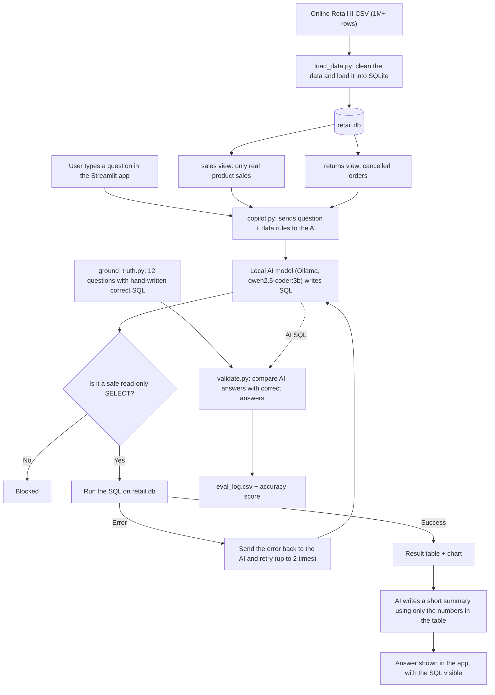

# AI-Powered Business Analytics Copilot

Ask business questions in plain English. A local AI model writes the SQL, the app runs it on 1M+ retail transactions, and every answer is checked against SQL I wrote by hand.

**Built with:** Python, SQLite, pandas, Ollama (qwen2.5-coder:3b), Streamlit

---

## What is this project?

A business person often asks questions like *"What was our revenue each month?"* or *"Which products sell the most?"* Normally an analyst has to write SQL code to answer them.

This project lets you **type the question in normal English**. Then:

1. An AI model (running on my own laptop through [Ollama](https://ollama.com), no cloud and no API key) turns the question into SQL.
2. The app runs that SQL on the sales data.
3. It shows a table, a chart, the SQL it used, and a short written summary.

AI can make mistakes, so I did not just trust it. I wrote the correct SQL for 12 test questions by hand and measured how often the AI gets the same answer. The mistakes I found are listed below, honestly.

**Dataset:** Online Retail II from the UCI Machine Learning Repository. It has 1,067,371 rows of sales from a UK online gift shop, from December 2009 to December 2011, in British pounds (GBP).

---

## Screenshots

### The app


### Asking for monthly revenue

The app shows the summary, the result table, and the SQL the AI wrote, so you can check it.


### Asking for the top 10 products


### Sales dashboard

An interactive dashboard on the same cleaned data, with a country filter, four headline numbers, revenue by month, top 10 products and top 10 countries (excluding the UK). Its numbers match my hand-written SQL answers (average order value £508.91 and repeat customers 72.35%).


---

## How the project works (flowchart)



---

## How I built it, step by step

**Step 1: Get and explore the data.**
I downloaded the Online Retail II file and looked at it with pandas before using any AI. The data is messy:
- 19,494 lines are cancelled orders (the invoice number starts with "C" and quantities are negative)
- Some "products" are really fees, such as postage (`POST`), `ADJUST` and `AMAZONFEE`
- 243,007 lines have no customer ID (guest checkouts)
- 6,207 lines have a price of zero or below
- 34,335 rows are exact duplicates (I kept them, because the same item can be scanned twice on one order)

**Step 2: Clean the data and put it in a database.**
`load_data.py` loads everything into a SQLite database and creates two clean "views":
- `sales`: real product sales only (1,037,004 lines)
- `returns`: cancelled and returned lines (18,285 lines)

The AI only looks at these clean views, not the messy raw table. This alone prevents many mistakes.

**Step 3: Write the answer key.**
In `ground_truth.py` I wrote the correct SQL by hand for 12 business questions (total revenue, monthly revenue, top products, top countries, average order value, repeat customers, return rate and more). I checked each answer myself. This is what the AI gets graded against.

**Step 4: Build the copilot engine.**
`copilot.py` does the main work:
- Sends the question to the local AI model, together with the table description and some business rules (for example "an order is a distinct invoice, not a row")
- Only allows a single read-only `SELECT` query, on a read-only database connection, so the AI can never change the data
- If the SQL fails, it sends the error back to the AI to fix it, up to 2 times
- Asks the AI for a short summary that may only use numbers already in the result table

**Step 5: Build the app.**
`app.py` is a Streamlit web app with example buttons, a question box, the summary, the result table, an automatic chart, and the SQL shown so a person can check it.

**Step 6: Test the AI against the answer key.**
`validate.py` asks the AI all the test questions, compares each result with my hand-written answer, and saves everything to `eval_log.csv`. I ran it for two different models.

**Step 7: Find the mistakes and fix what I could.**
`inspect_failures.py` shows the AI's SQL next to the correct answer for every failed question. I added clearer business rules to the prompt (for example "a product is identified by its stock code" and "return questions must use the returns view") and measured again.

**Step 8: Build a dashboard.**
I built a dashboard on the same cleaned data, and compared its headline numbers (average order value and repeat-customer rate) with my hand-written SQL answers.

---

## Results

I tested two small models that run on a normal laptop:

| Test set | Model | Correct answers | Accuracy |
|---|---|---|---|
| First 7 questions | qwen2.5-coder:3b | 4 of 7 | 57% |
| First 7 questions | gemma2:2b | 3 of 7 | 43% |
| All 12 questions | gemma2:2b | 5 of 12 | 42% |
| All 12 questions | qwen2.5-coder:3b | 9 of 12 | 75% |

**What this shows:** the coding-focused model (Qwen) is clearly better at writing SQL than the general model (Gemma) on the same questions.

**Please note:** the 57% score was measured on the first 7 questions, and the 75% score on all 12 questions, so they are not a fair before-and-after comparison. Twelve questions is also a small test, so treat these numbers as early results.


---

## Where the AI got it wrong

This is the most important part of the project. Small AI models make confident mistakes, and the answer-key test caught them.

**1. Repeat customers: 13,715% instead of 72.35%.**
The question was "what percentage of customers made more than one purchase?" The AI counted all order lines instead of counting customers with more than one distinct order. A percentage over 100 is impossible, which made the error easy to spot.

**2. Return rate: 0% (and 100% in the app) instead of 3.61%.**
The AI looked for negative amounts in the `sales` view, where cancellations have already been removed, so it found none. It should have used the `returns` view. The app then turned the wrong number into a nonsense summary about "return on investment".


**3. Countries outside the UK: wrong filter and an invented number.**
The AI wrote `country != 'UK'`, but the data uses the name `United Kingdom`, so the UK stayed in the result. The written summary then claimed France and Germany earned £1,723,390,129 each, a number that is not in the table at all.


**4. Top 10 products: the question has more than one valid answer.**
646 stock codes in this dataset have more than one description. Grouping by stock code, by description, or by both gives three slightly different top-10 lists. My first answer key was ambiguous. After I added the rule "a product is identified by its stock code", the generated SQL groups by `stock_code` (see the SQL in the top-10 screenshot above).

**What I took from this:**
- Always read the SQL the AI wrote. A wrong number can look believable.
- A test set only works if the questions have one clear answer.
- The written summary can be wrong even when the table is right, so the app always shows the SQL and the table next to the summary.

---

## Known limitations

- Small local models still fail on harder questions, especially the percentage and return-rate ones.
- The summary text sometimes picks one number from the table and presents it as the whole answer, or misreads a number.
- 12 test questions is a small sample.
- The app does not remember earlier questions (every question is separate).

## Ideas for next steps

- Automatically flag impossible results (for example a percentage above 100) before showing them
- Add few-shot example questions to the AI prompt and measure the change on a separate held-out set of questions
- Try a larger model (for example `qwen2.5-coder:7b`) and compare accuracy
- Add more test questions with window functions (month-over-month growth, running totals)

---

## Project files

| File | What it does |
|---|---|
| `explore.py` | First look at the raw data and its problems |
| `load_data.py` | Cleans the data and builds the SQLite database with the `sales` and `returns` views |
| `check.py` | Quick check that the database loaded correctly |
| `ground_truth.py` | The 12 test questions with hand-written correct SQL |
| `copilot.py` | The engine: question to SQL to result to summary |
| `test_copilot.py` | Tries one question from the terminal |
| `app.py` | The Streamlit web app |
| `validate.py` | Grades the AI against the answer key and writes `eval_log.csv` |
| `inspect_failures.py` | Shows the AI's wrong SQL next to the correct answer |
| `screenshots/` | Images used in this README |

---

## How to run it

You need Python 3.10 or newer and [Ollama](https://ollama.com/download).

```
# 1. Download a model
ollama pull qwen2.5-coder:3b

# 2. Create and activate a virtual environment (Windows)
python -m venv venv
venv\Scripts\activate

# 3. Install the libraries
pip install -r requirements.txt

# 4. Put online_retail_II.csv in this folder, then build the database
python load_data.py

# 5. Start the app
streamlit run app.py

# 6. (Optional) Test the AI against the answer key
python validate.py
```

The dataset is not included in this repository because of its size. Download **Online Retail II** from the UCI Machine Learning Repository and save it as `online_retail_II.csv` in the project folder.

To try another model, set the model name before running (Windows):

```
set COPILOT_MODEL=gemma2:2b
python validate.py
```

---

## Author

**Sujal Mane**, data science graduate (B.E. Electronics and Telecommunication).
Dataset credit: UCI Machine Learning Repository, Online Retail II.
